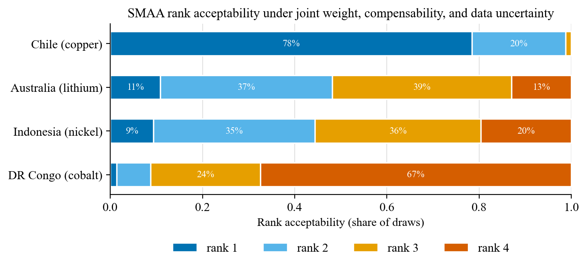

# ISEE: Integrated Sustainable Economic Efficiency

ISEE is a Python research project for comparing critical mineral systems beyond the value of mine production. It asks which ranking conclusions hold when modeling assumptions change, and which groups emerge from the systems’ full profiles.

The [dataset](data/mineral_systems.csv) covers 30 country–mineral systems in 17 countries across copper, lithium, nickel, and cobalt. Ten indicators describe five dimensions: financial value, managerial and institutional flexibility, strategic value, environmental burden, and exposure to long-term liabilities. The baseline averages min–max normalized indicators within each dimension, then combines the five scores with equal weights, subtracting burden and liability scores. Scores are relative to the comparison set, and several indicators describe national conditions rather than individual mines.

## What the analysis finds

**Ranking robustness.** The four case studies are Chilean copper, Australian lithium, Indonesian nickel, and cobalt in the Democratic Republic of the Congo. The [comparison of model specifications](results/table3_specifications.csv) tests equal, entropy, and CRITIC weights, as well as geometric aggregation. Australia and Indonesia swap second and third place under entropy weighting. Separate Monte Carlo experiments vary weights (10,000 draws) or perturb inputs by ±10% (5,000 draws). The baseline order holds in all 5,000 draws of the input-noise experiment.

The joint stochastic multicriteria acceptability analysis (SMAA) varies weights, inputs, and how much a strength in one dimension can offset a weakness in another. In 20,000 scenarios, Chile ranks in the top two in [98.8% of draws](results/smaa_acceptability.csv), while Australia outranks Indonesia in [53.4%](results/smaa_pairwise.csv).



**Cluster typology.** The full sample is clustered on the five dimension scores using k-means, with Ward clustering as a comparison. [Six clusters](results/table7_cluster_profiles.csv) are selected for bootstrap stability among solutions with near-maximal silhouette scores. They include institutionally strong extractive systems and refining hubs with high environmental burdens. Resampling whole countries gives a [mean adjusted Rand index](results/cluster_selection_metrics.csv) of 0.780 against the original partition, compared with 0.832 when resampling individual systems.

## Reproduce the analysis

Use Python 3.11, the version used in [CI](.github/workflows/ci.yml).

```bash
git clone https://github.com/aslelekova/isee-framework.git
cd isee-framework
python3.11 -m venv .venv
source .venv/bin/activate
python -m pip install -r requirements.txt
python run_analysis.py
python -m unittest discover -s tests -v
```

[`run_analysis.py`](run_analysis.py) rebuilds the CSV tables in [`results/`](results/) and PNG figures in [`figures/`](figures/). The [codebook](CODEBOOK.md) defines the indicators; [data provenance](DATA_PROVENANCE.csv) records their sources and vintages.

## Paper and citation

Companion code and data for *Multidimensional Assessment of Critical Mineral Systems: Financial, Institutional, Strategic and Environmental Factors*, accepted for publication in *Russian Mining Industry*.

See [`CITATION.cff`](CITATION.cff) for the software citation and [`LICENSE`](LICENSE) for the MIT license.
